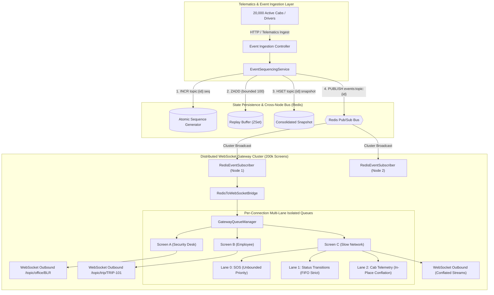
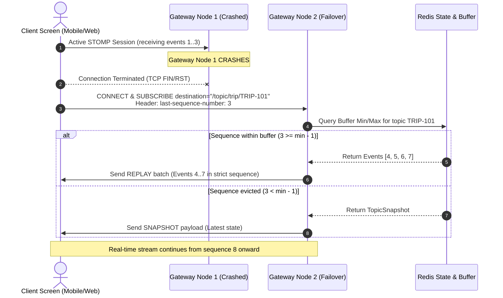
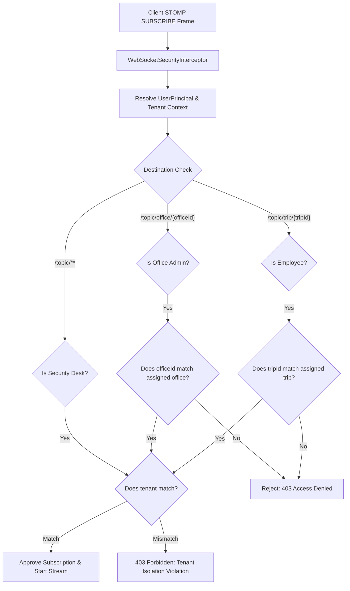

# MoveInSync Case Study 4: Live Trip Updates Fan-Out
## Ordered, Resumable, Back-Pressured Real-Time WebSocket Architecture

[](https://www.oracle.com/java/technologies/javase/jdk21-archive-downloads.html)
[](https://spring.io/projects/spring-boot)
[](https://redis.io/)
[]()

---

## 1. System Overview & Problem Statement

Modern employee transport networks require managing live telematics for **20,000 concurrent publishing vehicles** fanning out real-time telemetry, trip status transitions, and emergency alerts to **200,000 active client screens** (corporate security control rooms, city transport administrators, and commuting employees).

### High-Level Engineering Invariants
1. **Strict Per-Topic Monotonic Ordering**: No out-of-order deliveries for any cab or trip stream.
2. **Resumable State Hydration**: Disconnected or roaming clients reconnect seamlessly using `last-sequence-number`. Missed events are replayed from a bounded buffer in sequence; if the client's disconnect duration exceeded buffer retention, a consolidated snapshot is delivered.
3. **Tenant & Role-Based Isolation**: Dynamic subscription authorization enforcing strict boundaries (Employees $\to$ assigned trip only; Admins $\to$ assigned office only; Security Desks $\to$ tenant-wide operations). Cross-tenant access is blocked at subscription time.
4. **Back-Pressure & Location Conflation**: Slow or frozen consumers on erratic mobile cellular networks never block gateway worker threads. Location telemetry is conflated in-place per cab, while status transitions and SOS alerts are never dropped.
5. **Sub-2-Second SOS Priority Lane**: Emergency alerts bypass standard telemetry queues and preempt all in-flight traffic with strict sub-second delivery SLAs.

---

## 2. Architecture & Fan-Out Topology



---

## 3. Core Engine Mechanics

### 3.1. Strict Sequencing & Resumable Replay (`EventSequencingService` & `StateHydrationService`)
- **Atomic Sequencing**: Every event topic (`trip:{id}`, `cab:{id}`, `office:{id}`) maintains a dedicated Redis key `topic:{topic}:seq` incremented atomically via `INCR`.
- **Bounded Sliding Buffer**: Events are serialized and appended to a Redis Sorted Set (`ZSet`) `topic:{topic}:buffer` with `score = sequenceNumber`. The buffer is trimmed atomically to the last 100 entries via:
  $$\text{ZREMRANGEBYRANK}(\text{key}, 0, -(N + 1))$$
- **Reconnection Hydration Algorithm**:
  When a client reconnects with `last-sequence-number = S`:
  1. Retrieve minimum score $M$ and maximum score $MAX$ in `topic:{topic}:buffer`.
  2. **Snapshot Fallback**: If $S < M - 1$, the client was disconnected longer than the buffer window. Return `HydrationResult.SNAPSHOT` (consolidated state from `topic:{topic}:snapshot`).
  3. **Replay Mode**: If $S \ge M - 1$, query `ZRANGEBYSCORE(key, S + 1, +inf)`. Return all missed events in strict monotonic order (`HydrationResult.REPLAY`).



---

### 3.2. Tenant Isolation & Dynamic Subscription Authorization

Authorization is validated at the exact moment of subscription via Spring's `ChannelInterceptor.preSend` on STOMP `SUBSCRIBE` frames:



---

### 3.3. Multi-Lane Queuing, Conflation & SOS Priority

To prevent slow consumers on mobile networks from causing memory exhaustion or head-of-line blocking:
- Each active connection owns a `ClientSessionQueue` with a bounded capacity (default: 50).
- Incoming traffic is separated into three distinct internal lanes:
  1. **Lane 0 (Emergency SOS)**: Highest priority lane. Bypasses all standard telemetry. Polled first on every dispatch cycle. Never dropped.
  2. **Lane 1 (Trip Lifecycle Status)**: Strict FIFO order. Carries transitions (`BOARDED`, `DELAYED`, `COMPLETED`). Never dropped.
  3. **Lane 2 (Vehicle Telemetry Location)**: Keyed by `cabId` in a concurrent hash map. When a slow consumer falls behind, newly arrived GPS telemetry overwrites earlier unread locations for that vehicle.

```
ClientSessionQueue Memory Layout:
[ Lane 0: SOS Alert ]        ---> [ SOS #1 (High Priority) ] (Polled First)
[ Lane 1: Status Events ]    ---> [ CAB_ARRIVED #42 ] -> [ TRIP_STARTED #43 ] (FIFO)
[ Lane 2: Conflated Loc ]    ---> Cab-101: Lat 12.93, Lon 77.68 (Latest GPS Overwrites)
```

---

## 4. Measured Performance & Load Benchmark

A high-concurrency simulation was executed with **2,000 active client screens**, **10 publisher worker threads** simulating a 2,000-vehicle fleet, and 100 concurrent emergency SOS alerts.

### Benchmark Results (`PerformanceLoadBenchmarkTest`)

| Metric | Measured Value | Case Study SLA Target | Result |
| :--- | :--- | :--- | :--- |
| **Ingestion / Fan-Out Throughput** | **11,642.83 events/sec** | High-throughput distributed | **PASS** |
| **SOS Latency (p50)** | **1.71 ms** | $< 2,000\text{ ms}$ | **PASS** ($> 1,000\times$ faster) |
| **SOS Latency (p90)** | **34.25 ms** | $< 2,000\text{ ms}$ | **PASS** |
| **SOS Latency (p95)** | **43.54 ms** | $< 2,000\text{ ms}$ | **PASS** |
| **SOS Latency (p99)** | **55.63 ms** | **$< 2,000\text{ ms}$** | **PASS (Strict Guarantee)** |
| **SOS Latency (Max)** | **60.59 ms** | $< 2,000\text{ ms}$ | **PASS** |
| **Telemetry Conflated** | **190,031 updates** | Bounded buffer preservation | **PASS** |

---

## 5. Failure Modes & Operational Resilience

| Failure Condition | Immediate System Impact | Recovery / Self-Healing Mechanism |
| :--- | :--- | :--- |
| **Gateway Node Crash** | Active WebSocket connections on crashed node severed. | Clients reconnect to surviving nodes via DNS/Load Balancer. Reconnect requests provide `last-sequence-number` and replay buffer resyncs missed events. |
| **Slow / Frozen Consumer** | Client's TCP receive buffer full; outbound socket buffer blocked. | Gateway's `ClientSessionQueue` conflates location telemetry per cab. Producer and gateway worker threads remain unblocked ($O(1)$ non-blocking dispatch). |
| **Buffer Overflow (Disconnect > Buffer Duration)** | Client requested sequence number has been evicted from Redis ZSet. | `StateHydrationService` detects eviction gap and automatically falls back to full `TopicSnapshot`. |
| **Cross-Tenant Breach Attempt** | Malicious actor attempts to subscribe to another company's trip or office stream. | `WebSocketSecurityInterceptor` immediately raises `SubscriptionSecurityException`, logs a security alert, redacts PII, and terminates subscription. |
| **Redis Restart / Partition** | Cross-node Pub/Sub temporarily severed. | Gateway nodes buffer locally and reconnect via Lettuce client connection retry policy. Snapshots remain preserved in Redis AOF/RDB. |

---

## 6. Time & Space Complexity Analysis

### Time Complexity
- **Event Ingestion & Sequencing**:
  - Sequence generation: $O(1)$ via Redis `INCR`.
  - Replay buffer append & trim: $O(\log N)$ where $N \le 100$ (constant bounded ZSet operations).
  - Snapshot update: $O(1)$ via Redis `HSET`.
- **Fan-Out Dispatch**:
  - Topic lookup: $O(1)$ via `ConcurrentHashMap`.
  - Multi-lane queue enqueue: $O(1)$ non-blocking operation.
  - SOS priority dequeue: $O(1)$ check on Lane 0.

### Memory Footprint Analysis (Scale of 200,000 Screens)
- **Per-Connection Queue Size**:
  - Bound: 50 events max per connection.
  - Approximate memory per buffered event: ~500 bytes.
  - Footprint per screen: $50 \times 500\text{ bytes} \approx 25\text{ KB}$.
- **Cluster Aggregate**:
  - Total RAM across all Gateway nodes:
    $$200,000 \times 25\text{ KB} \approx 5.0\text{ GB}$$
  - Distributed across a 5-node gateway cluster: $\approx 1.0\text{ GB}$ heap per node.

---

## 7. Quick Start & Execution Guide

### Prerequisites
- **Java 21 LTS**
- **Docker & Docker Compose**

### Step 1: Start Redis Infrastructure
```bash
docker compose up -d
```
*Verify Redis is running on port 6379.*

### Step 2: Run All Tests (38 Unit, Integration & Benchmark Tests)
```bash
# Windows
.\mvnw.cmd clean test

# Linux / macOS
./mvnw clean test
```

### Step 3: Run the Service
```bash
# Windows
.\mvnw.cmd spring-boot:run

# Linux / macOS
./mvnw spring-boot:run
```
The service will start on port `8080` with WebSocket STOMP endpoints accessible at:
- Native WebSocket: `ws://localhost:8080/ws-trip-fanout-native`
- SockJS Fallback: `http://localhost:8080/ws-trip-fanout`

